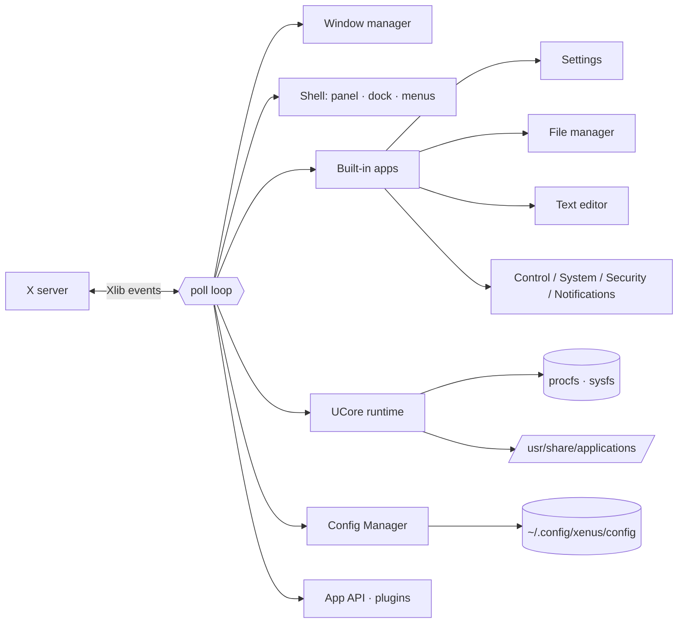
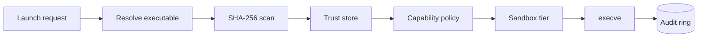

<div align="center">

# XENUS

### Solo Coding Desktop Environment

*Minimal desktop. Maximum control.*

A lightweight Linux desktop environment written from scratch in **C11 + Xlib**.

<br>


<br>


<sub><i>Interface capture from an earlier revision · the current Harbor shell uses traffic-light controls and a floating dock.</i></sub>

<br><br>

<table>
  <tr>
    <td align="center">
      <br>
      <sub><b>Application Menu</b></sub>
    </td>
    <td align="center">
      <br>
      <sub><b>Applications</b></sub>
    </td>
    <td align="center">
      <br>
      <sub><b>Missing Program Notice</b></sub>
    </td>
  </tr>
</table>

</div>

---

## Overview

**XENUS** is a lightweight window manager and desktop environment written from
scratch in **C11 + Xlib** and built with a plain **Makefile**. It runs as a
single event-driven process: no busy polling, no threads, no daemons, no
GTK/Qt/Electron, no compositor.

The goal is a small, readable, self-contained desktop that is pleasant to use
on modest hardware — initially an **ARM64** phone running Ubuntu under PRoot
with **Termux:X11** as the X server, and portable to ordinary Linux desktops.

| | |
|---|---|
| **Version** | 0.2 |
| **Language** | C11 |
| **Display stack** | Xlib (core X11 only) |
| **Build system** | GNU Make |
| **Process model** | One process · one thread · one `poll()` loop |
| **Runtime dependencies** | `libX11`, `libcrypt`, `libc` (`-ldl` is folded into libc on modern glibc) |
| **Binary size** | ~520 KB (~450 KB stripped) |
| **Primary target** | ARM64 Linux (Ubuntu under PRoot + Termux:X11) |
| **Status** | Active development |
| **License** | MIT |

### Documentation

| Document | Contents |
|---|---|
| [`docs/XENUS_APP_API.md`](docs/XENUS_APP_API.md) | App API, event queue, windows, notifications and plugin ABI |
| [`docs/UCORE.md`](docs/UCORE.md) | UCore runtime, snapshots, registries, events and hardware probe |
| [`docs/BIOS.md`](docs/BIOS.md) | XENUS BIOS / X-FIRM pages and recovery boundaries |
| [`config/xenus-config.sample`](config/xenus-config.sample) | Annotated configuration template |

---

## Table of Contents

- [Overview](#overview)
- [Documentation](#documentation)
- [Current Status](#current-status)
- [Features](#features)
- [Keyboard Shortcuts](#keyboard-shortcuts)
- [Architecture](#architecture)
- [Security Model](#security-model)
- [App API and Plugins](#app-api-and-plugins)
- [HAL](#hal)
- [Requirements](#requirements)
- [Build](#build)
- [Run](#run)
- [Debug](#debug)
- [Testing](#testing)
- [Install / Uninstall](#install--uninstall)
- [Configuration](#configuration)
- [Design Notes](#design-notes)
- [Platform Support](#platform-support)
- [Roadmap](#roadmap)
- [Limitations](#limitations)
- [Future Vision](#future-vision)
- [Contributing](#contributing)
- [License](#license)
- [Screenshots](#screenshots)

---

## Current Status

### Implemented

<table>
<tr><td width="170"><b>Window management</b></td><td>

Reparenting title-bar frames with macOS-like chrome (red/yellow/green dots on
the left, glyphs on hover, title beside the controls), focus-follows-mouse (or
click-to-focus with `focus_follows_mouse=0`), `Alt`+drag move,
`Alt`+right-drag / edge resize, double-click title to maximize,
`Alt+Up` / `Alt+Down`, half-screen snap, `Alt+Tab` / `Shift+Alt+Tab`, `Alt+F4`,
`Alt+D` (show desktop), `_NET_WM_STATE_FULLSCREEN`, `ConfigureRequest` handling.

</td></tr>
<tr><td><b>Panel</b></td><td>

Harbor shell: a slim top menu bar (XENUS mark, active application with
About/Hide/Close, Window menu, Help menu, tray glyphs, macOS-style clock) and a
centered floating bottom dock (launcher tile, one tile per running application
with a multi-window count badge and a running dot per window, accent dots for
the focused one; left click focuses/restores, middle click closes, right click
opens the app menu, hovering a running tile reveals a close button).

</td></tr>
<tr><td><b>Application menu</b></td><td>

Pinned entries plus every `/usr/share/applications/*.desktop`, compact and
searchable (type to filter, arrows to move, `Enter` runs, `Esc` closes),
`Alt+Space`.

</td></tr>
<tr><td><b>Command launcher</b></td><td>

`Alt+F2`, runs a command or opens a URL in the detected browser.

</td></tr>
<tr><td><b>Desktop menu</b></td><td>

Right click on the wallpaper: terminal, editor, file manager, browser, Run…,
Applications, New Folder, New File, Refresh, Control Center, System Center,
Notifications, Security Center, Log out.

</td></tr>
<tr><td><b>Desktop shortcuts</b></td><td>

`~/Desktop` is drawn on the wallpaper: click to select, double click to open
(`*.desktop` runs its `Exec=`), right click for Open / Open in File Manager /
Properties / Set as wallpaper / Refresh, drag to rearrange (positions kept in
`~/.local/share/xenus/desktop.layout`).

</td></tr>
<tr><td><b>Message dialogs</b></td><td>

Including the Plasma-style "program not installed" notice instead of failing
silently.

</td></tr>
<tr><td><b>Security Center</b></td><td>

Built-in security application (no terminal): tray shield or the launcher's
"Security Center" entry opens a card-style window with a live status pill, the
protection mode (Always-on / Passive / Off), bounded scans (plugins / Desktop /
Home), permission toggles and a scrollable security log.

</td></tr>
<tr><td><b>System Center</b></td><td>

The built-in system application (`Alt+X`): Overview (CPU/memory/load/uptime),
Processes with real `TERM`/`STOP`/`CONT` actions, Applications from the
freedesktop registry, Services, Device facts from procfs/sysfs/uname, and the
UCore activity log. All data comes from UCore; nothing is mocked.

</td></tr>
<tr><td><b>Control Center</b></td><td>

Android-inspired quick settings (`Alt+C`): Wi-Fi, Bluetooth, Airplane mode, Do
Not Disturb, light/dark appearance and a System Center shortcut, plus volume and
brightness sliders, battery / external-power state, workspace switcher and a
Desktop Settings page (theme, accent, animations). Capabilities the host does
not expose are drawn as *not exposed* and never toggle a dummy.

</td></tr>
<tr><td><b>Settings</b></td><td>

Standalone configuration window (`Alt+I`) with ten-category navigation.
**Personalization** (dark/light theme, accent, wallpaper picker with live
preview) and **Desktop** (menu-bar height, system tray, animations and desktop
icons) are live and persist through the Config Manager. The other categories
are placeholders for later phases.

</td></tr>
<tr><td><b>Notification Center</b></td><td>

`Alt+N` or the tray bell: notification history from the App API ring, unread
badge, Do Not Disturb, clear-all and wheel scrolling, with an empty-state card
when there is nothing to show.

</td></tr>
<tr><td><b>Lock screen</b></td><td>

Optional password gate backed by `~/.config/xenus/.auth` (`crypt` hash, five
failed attempts). Set or remove the password in Security Center → Account
Protection; lock immediately from Control Center → Lock Screen. When enabled,
XENUS asks for the password before creating the desktop.

</td></tr>
<tr><td><b>Account recovery</b></td><td>

`xrecovery` manages the recovery path: `status` reports whether authentication
and a recovery verifier exist, `enroll` issues a one-time 64-character recovery
key (after a password is set), and `bypass` consumes that key to set a new
password. Recovery actions are audited.

</td></tr>
<tr><td><b>Text editor</b></td><td>

Native Xlib editor with UTF-8 byte storage, a 4 MiB buffer limit, cursor
movement, `Ctrl+S` save, `Ctrl+Q` close and a status line. Opens text files from
the file manager or desktop; with unsaved changes, a second close discards them.

</td></tr>
<tr><td><b>UCore</b></td><td>

The dependency-free hybrid C runtime inside the XENUS process (no daemon, no
threads): sysinfo/load/procfs process snapshots, the freedesktop app registry,
service and module registries, a bounded log ring, an event bus and an honest
hardware probe. The event loop calls `xenus_core_tick()`; see
`include/xenus/ucore.h` and `docs/UCORE.md`.

</td></tr>
<tr><td><b>Workspaces</b></td><td>

Four workspaces with `Ctrl+Alt+Left/Right` to switch and
`Ctrl+Alt+Shift+Left/Right` to move the active window. Existing single-desktop
behaviour is unchanged until you switch.

</td></tr>
<tr><td><b>Sandbox limits</b></td><td>

Every sandboxed process gets a 3 GiB RAM ceiling (3072 MiB, `RLIMIT_DATA`
applied in the child before exec, capped and never raised; configurable down via
`sandbox_memory_mb`), while XENUS imposes no CPU quota of its own — the host
scheduler decides.

</td></tr>
<tr><td><b>Security layer</b></td><td>

Path validation, SHA-256 scanning, trust and capability policy, a fail-closed
spawn gate, runtime-verified sandbox tiers (RESTRICT / FULL), plugin gating
before `dlopen()`, and a 64-entry audit ring. Bait and Mirage decoys are advisory
detection only. See [Security Model](#security-model).

</td></tr>
<tr><td><b>File manager</b></td><td>

`Alt+E`, Finder-inspired: compact toolbar with Back / Forward / Up, path field,
live search filter (`Ctrl+F`), Name/Size/Kind column headers, Favorites +
Locations sidebar (Home, Desktop, Documents, Downloads, …, Computer), navigate,
open, rename (`F2`), delete (confirmed), new folder (`Ctrl+N`), hidden files
(`Ctrl+H`), right-click menu, clear errors for unreadable folders.

</td></tr>
<tr><td><b>Media</b></td><td>

Files are classified by extension and opened with an installed viewer: images →
`feh`, video/music → `mpv`; `wallpaper=` in the config loads a background image.

</td></tr>
<tr><td><b>Config Manager</b></td><td>

Schema-driven, typed configuration with three layers (built-in default → system
file → user file), fixed-size storage, validated keys and atomic `0600`
temp-file + `fsync` + rename writes. Credential-like keys are rejected.

</td></tr>
<tr><td><b>Cache</b></td><td>

A bounded, single-threaded cache registry with registration, trimming and
enforcement, so long-running surfaces do not grow without limit.

</td></tr>
<tr><td><b>Net API</b></td><td>

A dependency-free network helper for the App API: IPv4/IPv6 addresses, bounded
nameservers, configurable timeout and retries, plus availability/socket checks.

</td></tr>
<tr><td><b>Configuration</b></td><td>

`~/.config/xenus/config`, plain `key=value`, unknown keys reported and ignored,
built-in defaults when the file is missing.

</td></tr>
<tr><td><b>Lifecycle</b></td><td>

Single-instance `fcntl` lock, clean shutdown on `SIGINT`/`SIGTERM`/`SIGHUP` with
clients reparented back to the root.

</td></tr>
<tr><td><b>Test suite</b></td><td>

A **179-check** Xvfb suite plus headless HAL, cache, UCore, BIOS, Config Manager,
App API, security and Net API suites — **1,300+ checks** in total. See
[Testing](#testing).

</td></tr>
<tr><td><b>HAL</b></td><td>

A separate, dependency-free static library (`hal/libhal.a`) with GPU /
Bluetooth / Audio APIs, Linux and Android backends, and its own 182-check smoke
test.

</td></tr>
</table>

### In Development

- **HAL ↔ desktop integration.** The library builds, is tested, and detects this
  device's hardware, but `src/` does not link it yet. The panel's status glyphs
  are still drawn from fixed shapes, not from HAL data.
- **Remaining Settings categories.** Display, Input, Sound, Applications,
  System, Security, Android Integration and About are navigation placeholders;
  Personalization and Desktop are functional.

### Planned

Not implemented yet — see [Roadmap](#roadmap).

- Real system tray (`_NET_SYSTEM_TRAY` / XEmbed)
- Built-in terminal emulator
- Clipboard
- Power management
- Network and device integration wired to real status data
- Packaging: `.desktop` session entry and man page

---

## Features

| Area | Behaviour |
|---|---|
| **Look** | Harbor theme with macOS-like window chrome: reparented frame windows, calm charcoal gradient wallpaper with a quiet ellipse motif, dark title bar with red/yellow/green traffic-light dots on the left (glyphs on hover) and the title beside the controls; double-click title = maximize |
| **Window management** | `MapRequest`, `ConfigureRequest`, `DestroyNotify`, `UnmapNotify`, focus-follows-mouse, fullscreen via `_NET_WM_STATE_FULLSCREEN` |
| **Move** | `Alt` + left-drag, or drag the title bar |
| **Resize** | `Alt` + right-drag, or drag a window edge (5 px) |
| **Close** | `Alt+F4`, the left close dot, the dock hover (×), or the dock app menu — always a graceful `WM_DELETE_WINDOW` request; an application that does not advertise the protocol is never force-killed (a notice explains why) |
| **Maximize / minimize** | `Alt+Up` toggle, `Alt+Down`, the left maximize / minimize dots |
| **Snap** | `Alt+Left` / `Alt+Right` half screen |
| **Show desktop** | `Alt+D` or the Window menu's Show Desktop entry |
| **Switch windows** | `Alt+Tab`, `Shift+Alt+Tab` (wraps) |
| **Panel** | Harbor shell: slim top menu bar (XENUS mark, active application with About/Hide/Close, Window menu listing every window + Show Desktop, Help menu, tray glyphs for network / volume / battery / Control Center / Notifications / Security shield, macOS-style clock) and a centered floating bottom dock (launcher tile, one tile per running application with a window-count badge and one dot per window, accent dots + lifted tile for the focused one; left click focuses/restores, middle click closes, right click opens Show / Minimize / Maximize / Close / Quit, hover reveals a close button) |
| **App menu** | Pinned entries + every `/usr/share/applications/*.desktop`, type-to-search with icon tiles, `Alt+Space` or the launcher button |
| **Program detection** | Terminal / editor / browser picked from `PATH` (or your `terminal=`, `browser=` config); built-in menu entries are `@terminal`, `@editor`, `@files`, `@browser`, `@apps`, `@run`, `@desktop`, `@control`, `@control-settings`, `@notifications`, `@system`, `@security`, `@logout` |
| **Missing program** | A Plasma-style notice dialog tells you what to install instead of failing silently |
| **Desktop menu** | Right click on the wallpaper: terminal, editor, file manager, browser, Run…, Applications, New Folder, New File, Refresh, Control Center, System Center, Notifications, Security Center, Log out |
| **Desktop shortcuts** | `~/Desktop` on the wallpaper: click selects, double click opens (a `*.desktop` entry runs its `Exec=`), right click = icon menu, drag = rearrange (saved in `~/.local/share/xenus/desktop.layout`); installed applications are shown as icons on the left half (`desktop_apps=1`) |
| **Command launcher** | `Alt+F2` — runs a command, or opens a URL (`example.com`, `https://…`) in the detected browser |
| **Terminal** | `Alt+Enter` — starts the external terminal from `terminal=` or the first supported emulator found on `PATH` |
| **File manager** | `Alt+E` — built in, Finder-inspired: toolbar with Back / Forward / Up / New Folder / Refresh, path field, live search filter, Name/Size/Kind column headers, Favorites + Locations sidebar (Home, Desktop, Documents, …), navigate, rename (`F2`), delete, new folder, right-click menu, hidden files (`Ctrl+H`), clear errors for unreadable folders |
| **Text editor** | Native editor window: UTF-8 byte storage, 4 MiB limit, cursor handling, `Ctrl+S` save, `Ctrl+Q` close, status line; opens text files from the file manager or desktop |
| **Settings** | `Alt+I` — ten-category configuration window; Personalization and Desktop apply live and persist through the Config Manager. The remaining categories are placeholders |
| **Security Center** | Tray shield or launcher "Security Center": protection mode (Always-on starts the filesystem watcher), live status pill, bounded scanner (plugins / Desktop / Home), permission and policy toggles, Account Protection (set/remove the session password), scrollable security log with Clear |
| **Sandbox & policy** | Fail-closed spawn gate (resolve → scan → trust → policy), RESTRICT / FULL sandbox tiers verified at runtime, 3 GiB `RLIMIT_DATA` ceiling, plugin trust gate before `dlopen()`, 64-entry audit ring; Bait/Mirage decoys are advisory detection only |
| **System Center** | `Alt+X` — Overview, Processes (real actions), Applications, Services, Device and Activity tabs backed by UCore |
| **XENUS BIOS** | `xfirm` opens the standalone firmware-style setup UI (X-FIRM): staged System / Drivers / UCore / Android / Boot / Recovery pages, Apply and recovery backups. Runs without the desktop or UCore; see `docs/BIOS.md` |
| **Control Center** | `Alt+C`, the tray tile or the launcher/desktop "Control Panel" entry — quick settings tiles, volume/brightness sliders, battery, workspaces, Desktop Settings (theme/accent/animations) and Lock Screen |
| **Notifications** | `Alt+N` or the tray bell — history, unread badge, DND, clear all |
| **Workspaces** | `Ctrl+Alt+Left/Right` switches; `Ctrl+Alt+Shift+Left/Right` moves the active window |
| **Media** | Photos open with `feh`, video/music with `mpv`; `wallpaper=` in the config sets the background |
| **Config** | `~/.config/xenus/config` (key=value). Settings and live preferences write through the Config Manager (`built-in → /etc/xenus/config → user file`), preserving comments and unrelated keys |
| **Shutdown** | Clean `SIGINT`/`SIGTERM`/`SIGHUP` handling, clients reparented back to the root |
| **Single instance** | `fcntl` lock file in `$XDG_CACHE_HOME/xenus` (auto-released on crash) |

Extra EWMH support: `_NET_ACTIVE_WINDOW`, `_NET_CLIENT_LIST`, `_NET_SUPPORTED`,
`_NET_SUPPORTING_WM_CHECK`, `WM_STATE`, and window-title tracking in the menu bar.

---

## Keyboard Shortcuts

| Shortcut | Action |
|---|---|
| `Alt+F4` | Close the focused window (graceful `WM_DELETE_WINDOW`) |
| `Alt+Tab` / `Shift+Alt+Tab` | Switch windows |
| `Alt+Up` / `Alt+Down` | Maximize / minimize |
| `Alt+Left` / `Alt+Right` | Snap to half screen |
| `Alt` + drag | Move a window |
| `Alt` + right-drag | Resize a window |
| `Alt+D` | Show desktop |
| `Alt+Space` | Application menu |
| `Alt+F2` | Command launcher |
| `Alt+Enter` | Detected terminal |
| `Alt+E` | File manager |
| `Alt+I` | Settings |
| `Alt+C` | Control Center |
| `Alt+X` | System Center |
| `Alt+N` | Notification Center |
| `Alt+S` | Security Center |
| `Ctrl+Alt+Left/Right` | Switch workspace |
| `Ctrl+Alt+Shift+Left/Right` | Move window to workspace |

Inside built-in windows:

| Context | Shortcut | Action |
|---|---|---|
| File manager | `Ctrl+F` | Focus the live search filter |
| File manager | `Ctrl+N` | New folder |
| File manager | `Ctrl+H` | Toggle hidden files |
| File manager | `F2` | Rename the selected entry |
| Text editor | `Ctrl+S` | Save |
| Text editor | `Ctrl+Q` | Close (a second press discards unsaved changes) |
| Settings | `Esc` | Close |

---

## Architecture

```
xenus/
├── Makefile                  top-level build (this is what `make` runs)
├── README.md
├── config/
│   └── xenus-config.sample    annotated configuration template
├── docs/
│   ├── XENUS_APP_API.md       App API + plugin ABI reference
│   ├── UCORE.md               UCore runtime reference
│   └── BIOS.md                XENUS BIOS (X-FIRM) setup environment
├── include/xenus/             public App API headers
│   ├── app.h  event.h  plugin.h  window.h  notification.h  common.h
│   ├── config.h  config_manager.h  net.h  ucore.h  bios.h
│   └── security.h  security_bait.h  security_mirage.h  security_resource.h
├── plugins/example/           example plugin (built by `make plugins`)
├── src/                       the desktop itself — one process
│   ├── xenus.h                shared types, config struct, prototypes
│   ├── main.c                 X connection, setup, poll() loop, signals, lock
│   ├── wm.c                   client list, frame windows, focus, close, drag
│   ├── input.c                key/button grabs, Alt-drag, desktop clicks
│   ├── ui.c                   shared drawing primitives
│   ├── panel.c                top menu bar (XENUS/app/Window/Help, tray, clock)
│   ├── dock.c                 floating bottom dock (launcher, app tiles, dots)
│   ├── taskbar.c              unified registry for managed + internal windows
│   ├── launcher.c             application menu + Alt+F2 prompt
│   ├── desktop.c              desktop shortcuts: icons, menus, moving
│   ├── fm.c                   built-in file manager
│   ├── text_editor.c          native text editor
│   ├── settings.c             standalone Settings window
│   ├── settings_prefs.c       Settings ↔ Config Manager bridge
│   ├── config.c               legacy config parser
│   ├── config_manager.c       typed, layered, atomic configuration store
│   ├── cache.c                bounded cache registry
│   ├── auth_screen.c          password / lock screen
│   ├── apps.c                 program detection, launch helpers, media
│   ├── msgbox.c               modal message dialogs
│   ├── security_gui.c         built-in Security Center window
│   ├── system_center.c        System Center application (UCore-backed)
│   ├── control_center.c       Android-inspired quick settings panel
│   ├── notification_center.c  notification history + unread badge
│   ├── core/                  UCore runtime (auth, sysinfo, proc, apps, events)
│   ├── bios/                  standalone BIOS engine, Xlib setup UI, xfirm
│   ├── recovery/              xrecovery account-recovery CLI
│   ├── api/                   App API implementation (libxenusapp.a)
│   ├── plugin/                plugin loader + manager (dlopen)
│   ├── security/              scanner, policy, audit, trust, capabilities,
│   │                          sandbox, resource limits, Bait/Mirage decoys
│   └── util.c                 logging, spawn, colours, text helpers
├── hal/                       separate hardware abstraction library
│   ├── Makefile               builds libhal.a + its two tools
│   ├── include/hal/           hal.h, gpu.h, bluetooth.h, audio.h
│   ├── src/                   generic module logic (hal.c, gpu.c, ...)
│   │   ├── backends/linux/    DRM sysfs, rfkill/HCI, ALSA
│   │   └── backends/android/  Android detection + property/sysfs readers
│   └── tests/                 hal_smoke.c (182 checks), hal_info.c
├── tests/                     X11 and headless test suites
│   ├── run_tests.sh           Xvfb suite (timeout-guarded by make)
│   ├── api_test.c             App API tests (headless, 304 checks)
│   ├── ucore_test.c           UCore tests (43 checks)
│   ├── bios_test.c            BIOS engine tests (48 checks)
│   ├── bios_ui_test.sh        BIOS under Xvfb (optional end-to-end suite)
│   ├── security_test.c        security boundary tests (197 checks)
│   ├── cache_test.c           cache registry tests (20 checks)
│   ├── net_test.c             Net API tests (55 checks, `make test-net`)
│   ├── config_manager_test.c  layered config tests (366 checks)
│   ├── plugins/               badver/failinit test plugins
│   ├── testclient.c           minimal X client used by the suite
│   ├── rootpixel.c            reads the root window pixel
│   ├── screenshot.c           dumps the root window as PPM
│   └── shoot.sh               one-shot screenshot helper
└── screenshot*.png            captured example sessions
```

### Process model



One process, one thread, one `poll()` on the X socket — no daemon, no worker
pool, no background timer beyond the next clock tick.

### Build artifacts

All removed by `make clean`.

| Path | Produced by |
|---|---|
| `build/src/*.o`, `*.d` | `make` (release objects + auto header deps) |
| `build/libxenusapp.a` | `make` (App API + plugin system + core modules) |
| `build/plugins/*.so` | `make plugins` (example + test plugins) |
| `xenus` | `make` |
| `xenus-bios`, `xfirm`, `xrecovery` | `make` |
| `tests/testclient`, `rootpixel`, `screenshot`, `api_test`, `ucore_test`, `bios_test`, `security_test`, `cache_test`, `config_manager_test` | `make` |
| `tests/net_test` | `make test-net` |
| `build-debug/`, `xenus-debug` | `make debug` |
| `hal/src/**/*.o`, `hal/libhal.a`, `hal/tests/hal_smoke`, `hal/tests/hal_info` | `make hal` / `make test` |

`src/` and `hal/` are **independent**: the desktop does not link the HAL.
There is no `configure` script, no generated sources, and no submodules.

---

## Security Model

Security is built into the desktop process — there is no security daemon and no
privileged helper. The launch path is **fail-closed**: if a check cannot be
completed, the application is not started, and the decision is recorded.



| Control | Behaviour |
|---|---|
| **Spawn gate** | Resolve → scan → trust → policy. A denial stops the launch; there is no silent fallback |
| **Scanning** | SHA-256 hashing plus path validation and a bounded filesystem scanner (plugins, Desktop, Home) |
| **Trust & policy** | Trust store and per-application capability policy decide whether execution is allowed |
| **Sandbox tiers** | `RESTRICT` and `FULL`, selected per launch and verified at runtime |
| **Resource ceiling** | 3 GiB `RLIMIT_DATA` per sandboxed process (configurable downward via `sandbox_memory_mb`); no CPU quota is imposed by XENUS |
| **Plugin gate** | ABI/API version and trust checks run before `dlopen()`; a broken or untrusted plugin is marked failed and the session stays up |
| **Audit** | A fixed 64-entry audit ring records security decisions and recovery actions |
| **Decoys** | Bait and Mirage are **advisory detection only** — never a security boundary |

The sandbox is a launch-policy and resource-limit layer, not a container or VM.
Applications still run as the same user, and core X11 provides no per-client
isolation. See [Limitations](#limitations) for the threat-model boundaries.

---

## App API and Plugins

XENUS exposes a small native C API (`include/xenus/*.h`, implemented in
`src/api/` + `src/plugin/`, linked as `build/libxenusapp.a`): app lifecycle and
services, an event queue, notifications, read-only config access, minimal
top-level windows, a network helper, and a **plugin system**.

A plugin is one `.so` exporting `xenus_plugin_info` / `xenus_plugin_init` /
`xenus_plugin_shutdown`, validated against ABI + API version before `init()`
runs, communicating only through a versioned `xenus_api_t` table. Plugins are
discovered from `~/.local/share/xenus/plugins` (plus `$XENUS_PLUGIN_PATH`); a
broken plugin is logged, marked failed, and never takes the session down.

```c
/* include/xenus/plugin.h — the contract, in short */
const xenus_plugin_info_t *xenus_plugin_info(void);
int  xenus_plugin_init(const xenus_api_t *api);
void xenus_plugin_shutdown(void);
```

See **`docs/XENUS_APP_API.md`** for the full reference. `make test` runs the
headless API tests (`tests/api_test`, 304 checks) before the Xvfb suite. The Net
API has its own headless suite (`make test-net`, 55 checks).

---

## HAL

`hal/` is a standalone C11 static library (`libhal.a`) with **no external
dependencies** — only libc and kernel UAPI headers. It is built and tested by
its own Makefile; the top-level `make test` drives it.

### Modules and generic API

| Module | Header | Capabilities |
|---|---|---|
| GPU | `hal/gpu.h` | `HAL_GPU_CAP_RENDER`, `HAL_GPU_CAP_MODESET`, `HAL_GPU_CAP_SOFTWARE` |
| Bluetooth | `hal/bluetooth.h` | `HAL_BT_CAP_ADAPTER`, `HAL_BT_CAP_POWER`, `HAL_BT_CAP_DISCOVERY` |
| Audio | `hal/audio.h` | `HAL_AUDIO_CAP_PLAYBACK`, `HAL_AUDIO_CAP_CAPTURE`, `HAL_AUDIO_CAP_MIXER`, `HAL_AUDIO_CAP_PULSE` |

Generic lifecycle and discovery in `hal/hal.h`:

```c
hal_status_t hal_init(const hal_init_opts_t *opts);
void         hal_shutdown(void);
bool         hal_is_inited(void);
bool         hal_is_android(void);
bool         hal_module_available(hal_module_t module);
uint32_t     hal_available_mask(void);
hal_status_t hal_module_get_info(hal_module_t module, hal_module_info_t *out);
```

…plus per-module calls such as `hal_gpu_primary()`,
`hal_bluetooth_adapter_count()`, `hal_audio_device_count()`,
`hal_audio_get_master_volume()`, `hal_bluetooth_set_powered()`.

### Backends and hardware detection

- **Linux backend** — GPU from `/sys/class/drm` (vendor/device/driver/VRAM),
  Bluetooth from `/dev/rfkill` + HCI, audio from `/proc/asound` and `/dev/snd`.
- **Android backend** — selected when `/system/build.prop`,
  `/system/bin/app_process64` (or `app_process32`) exists; reads the same
  sysfs/property interfaces available on Android.
- `hal_init()` picks the backend at run time via `hal_is_android()`.

### Graceful handling of unavailable hardware

A module that cannot be probed reports `available = no`, `caps = 0x0`, and
per-call statuses such as `unsupported` / `unavailable` instead of failing the
process. Example on this ARM64/Android device:

```text
$ hal/tests/hal_info
HAL 0.1
available mask: 0x5
gpu:
  backend=android available=yes caps=0x1
  [0] Adreno (kgsl-3d0) vendor=Qualcomm(0x0000) driver=kgsl type=integrated ...
bluetooth:
  backend=android available=no caps=0x0
audio:
  backend=android available=yes caps=0x8
```

That is what the hardware on the development device exposes — it is **not** a
claim of support for any other GPU, adapter, or sound card. Anything the HAL
does not probe stays reported as unavailable.

> **Note:** the HAL is **not linked into `xenus`** yet (see
> [Current Status](#current-status)).

---

## Requirements

### Build

- `gcc` (override the compiler with `make CC=clang`)
- GNU `make`
- libX11 headers
- `libcrypt` headers (for the auth / lock-screen support)

```sh
sudo apt update
sudo apt install -y build-essential libx11-dev libcrypt-dev git
```

### Run

A running X server and a valid `$DISPLAY` (Termux:X11, Xorg, Xvfb…).

Optional but useful:

| Program | Used for |
|---|---|
| a web browser | `@browser` and `Alt+F2` URLs |
| `feh` | image viewing and wallpaper |
| `mpv` | video / audio |
| a terminal emulator | `Alt+Enter` / `@terminal` |

XENUS detects these on `PATH` and shows a dialog when one is missing.

### Test only

`xvfb`, `x11-utils` (`xwininfo`, `xprop`, `xdpyinfo`), `xdotool`, and `timeout`
(coreutils):

```sh
sudo apt install -y xvfb x11-utils xdotool
```

This is a C project — dependencies are system packages managed by the Makefile,
not a language-level requirements file.

### Note about Firefox on this PRoot image

Ubuntu 24.04 only ships a snap stub for Firefox, so it was installed manually on
the development device (not a XENUS dependency):

- Firefox ESR 140.17.0 → `/opt/esr/firefox`, launcher `/usr/local/bin/firefox`
- the launcher sets `MOZ_DISABLE_CONTENT_SANDBOX=1`: this device's kernel
  refuses `F_ADD_SEALS` (`EPERM`), which makes Firefox 15x reject its own shared
  memory and crash every content process
- first start takes ~15–40 s (profile creation), later starts are faster

---

## Build

```sh
make
```

Compiles the desktop, API, plugin and BIOS sources into `build/src/*.o` (with
`-MMD -MP` header tracking) and links the `xenus` binary, the X test helpers,
and the standalone `xenus-bios` / `xfirm` / `xrecovery` tools. Only the files
whose sources or headers changed are rebuilt.

Flags actually used:

```text
-std=c11 -D_POSIX_C_SOURCE=200809L -Wall -Wextra -Wpedantic -O2
```

No architecture flags (`-march`, `-mcpu`, …) are used: build natively for your
target. Override optimisation with `make OPT=-O0` or add extras with
`make EXTRA_CFLAGS=…`.

```sh
make hal        # build hal/libhal.a and its tools only
make bios       # build xenus-bios and the xfirm launcher only
make plugins    # build the example and test plugins
```

Link line: `-lX11 -ldl -lcrypt`. Binary: ~520 KB (~450 KB stripped), one process,
one thread. The Xvfb suite measured ~3.7 MB resident at idle and asserts
< 40 MB; real usage depends on the applications you open.

### Clean

```sh
make clean
```

Removes `build/`, `build-debug/`, the `xenus` / `xenus-debug` / BIOS / recovery
binaries, test binaries, legacy `src/*.o`, and all HAL artifacts. Sources,
Makefiles, `config/`, `docs/` and the screenshots are never touched.

---

## Run

```sh
make run                       # ./xenus
make run ARGS='-c my.conf'     # pass arguments through
```

Or run the binary directly:

```sh
./xenus                # uses ~/.config/xenus/config
./xenus -c my.conf     # explicit config
./xenus -v             # version
./xenus -h             # help + key bindings
```

**An X server is required**: XENUS calls `XOpenDisplay(NULL)`, so `$DISPLAY`
must be set. Without one it exits with `cannot open display ''`.

### XENUS BIOS

```sh
./xfirm                # open the setup environment
```

`xfirm` starts Termux:X11 when `$DISPLAY` is not reachable (on Android) and then
execs `xenus-bios`. The setup UI is fully standalone: it does not need `xenus` or
UCore and is the recommended recovery path when the desktop will not start. See
`docs/BIOS.md` for every page and the exact boundary of what BIOS can change.

### Account recovery

```sh
xrecovery status       # show whether auth and recovery are configured
xrecovery enroll       # enroll a recovery verifier
xrecovery bypass       # one-shot recovery path (audited)
```

Stop XENUS with `kill -TERM <pid>` (or Ctrl-C on the terminal that started it).
A second instance on the same account is refused by the single-instance lock.

---

## Debug

```sh
make debug
./xenus-debug
```

Builds `xenus-debug` from `build-debug/` with `-O0 -g`, keeping the release build
in `build/` / `xenus` untouched — you can switch between them without a
`make clean`.

---

## Testing

```sh
make test
```

`make test` runs the headless suites first, then the full Xvfb suite:

| Suite | Checks | Coverage |
|---|---:|---|
| HAL | 182 | hardware probe and graceful unavailable states |
| Cache | 20 | registration, trimming, bounds |
| UCore | 43 | lifecycle, sysinfo, process/app/service snapshots, events |
| BIOS | 48 | defaults, staged apply, validation, atomic store, backups |
| Config Manager | 366 | schema, layering, validation, atomic writes |
| App API | 304 | lifecycle, events, notifications, windows, plugins |
| Security | 197 | spawn gate, trust, policy, sandbox, audit, decoys |
| XENUS on Xvfb | 179 | the desktop itself, end to end |
| Net API | 55 | address parsing, bounds, availability (`make test-net`) |

That is **1,394 checks** across all suites. `make test` runs everything except
the Net API suite, which is intentionally separate.

The Xvfb suite covers startup and single-instance locking, menu bar and dock
geometry, background colour, window mapping and borders, `_NET_CLIENT_LIST`,
focus-follows-mouse, `Alt+Tab` in both directions, `Alt`+drag move/resize,
`ConfigureRequest`, `Alt+F4`, app menu open/close/run, `Alt+F2` prompt and URL
handling, help/version output, clean `SIGTERM` shutdown and restart, process and
thread counts, RSS, idle CPU and binary size, client destruction,
maximize/snap/minimize/show-desktop, the desktop menu and shortcuts, the
missing-program dialog, the file manager, the taskbar registry, the dock (growth,
restore, app menu, hover close, grouping, graceful quit), the sandbox memory key,
the Harbor redesign, and the UCore surfaces (Control Center, Notification Center,
System Center, workspaces).

The X suite is wrapped in a hard timeout (default **300 s**, override with
`make test TEST_TIMEOUT=600`) so it can never hang the build. It starts its own
Xvfb on display `:97` and a private `$HOME`, traps `INT`/`TERM` to kill Xvfb,
XENUS and test clients and to delete its temp directory — nothing is left
running and no log file grows. It counts only the XENUS instances on its own
display, so a desktop session running elsewhere on the machine does not affect
the result.

Needs `xvfb x11-utils xdotool`. Individual suites:

```sh
bash tests/run_tests.sh   # X suite alone
make -C hal test          # HAL alone
make test-net             # Net API alone
make test-bios            # BIOS engine alone
make test-bios-gui        # BIOS under Xvfb alone
```

---

## Install / Uninstall

```sh
make install                       # default prefix: /usr/local
make PREFIX=/opt/xenus install     # different prefix
make DESTDIR=/tmp/stage install    # staged install for packaging
make uninstall                     # remove exactly what install added
```

| Installed path (default prefix) | Contents |
|---|---|
| `/usr/local/bin/` | `xenus`, `xenus-bios`, `xfirm`, `xrecovery` |
| `/usr/local/share/xenus/config.sample` | annotated configuration template |
| `/usr/local/include/xenus/*.h` | public App API headers |
| `/usr/local/lib/libxenusapp.a` | static App API + plugin library |

All paths follow `PREFIX`, `BINDIR`, `LIBDIR`, `INCDIR` and `SHAREDIR`.

The HAL is a build-time library only and is not installed. XENUS currently has
no `.desktop` entry, man page, or session file — those are planned, not missing
steps you need to run.

---

## Configuration

`~/.config/xenus/config` — see [`config/xenus-config.sample`](config/xenus-config.sample):

```ini
# shell
panel_height=28
border_width=1
title_height=28
focus_follows_mouse=1

# desktop
theme=0                   # 0 = dark graphite, 1 = light paper
accent=0                  # 0 = Harbor blue, 1 = silver, 2 = graphite
animations=1
background=#0b0c10
wallpaper_top=#222b46
wallpaper_bottom=#08090e
desktop_apps=0            # 1 = installed apps as desktop icons

# menu bar
show_clock=1
clock_format=%a %d %b  %H:%M
clock_date_format=        # empty = single-line clock
show_tray=1

# sandbox
sandbox_memory_mb=3072    # per-process ceiling (MiB), 3 GiB

# programs (empty = auto-detect from PATH)
terminal=xterm
browser=
wallpaper=
font=

# pinned application-menu entries: menu=Label|command
menu=Terminal|xterm
menu=Editor|${EDITOR:-vi}
menu=Files|@files
```

The block above is abridged; the sample also documents every palette key
(`panel_*`, `title_*`, `menu_*`, `border_*`, `button_*`). A missing file means
built-in defaults, and unknown keys are reported and ignored.

The Settings app writes only the keys it owns, through the Config Manager's
merge saver, so comments and unrelated keys survive. Credential-like keys are
rejected — the lock-screen hash lives in `~/.config/xenus/.auth`, not here.

---

## Design Notes

- Single `poll()` on the X socket with a timeout computed to the next clock tick
  — the clock is the only scheduled wakeup. The Xvfb run measured 1 tick over
  3 s at idle; the suite asserts at most 3.
- Client windows **are** reparented into a frame window that carries the title
  bar and border; on shutdown they are reparented back to the root.
- Move/resize run inside a short nested loop over `XNextEvent` while a pointer
  grab is active (motion events are compressed); other events are dispatched
  normally during the drag.
- Key/button grabs are re-registered with every NumLock/CapsLock combination.
- Built-in applications are override-redirect windows drawn by the same
  self-rendered UI layer; a single taskbar registry makes them and external
  clients look identical to the panel.
- Configuration writes are atomic: temp file (`0600`) → `fsync` → `rename`.

---

## Platform Support

| Platform | Status |
|---|---|
| **ARM64 (aarch64) Linux** | Initial focus. Developed and tested on Ubuntu 24.04 under PRoot on an Android phone, X server: Termux:X11. |
| **x86_64 Linux** | Expected to build and run — there are no architecture-specific flags and no assembly — but this tree has not been tested on x86_64 hardware. |
| **Android / Termux** | XENUS runs under Termux:X11; the HAL's Android backend is selected automatically when Android system files are present. |
| **Wayland** | Not supported. XENUS is core X11 only. |

**A binary built for one architecture cannot simply be executed on another.** An
ARM64 `xenus` will not run on x86_64 (and vice versa): copy the source tree to
the target machine and run `make` there — there is nothing to cross-configure,
only a native compile.

The HAL's Android backend also depends on Android-specific kernel interfaces
(`/dev/rfkill`, sysfs layouts); on a plain Linux box the Linux backend is used
instead and reports whatever that machine actually exposes.

---

## Roadmap

Already shipped — see [Current Status](#current-status): window management,
the Harbor shell, application menu, command launcher, file manager, text editor,
settings, security layer, UCore-backed centers, locking and recovery,
configuration, tests, and the HAL library.

Planned next, in rough order:

1. **HAL integration** — link `libhal.a` into `xenus` and drive the panel's
   status glyphs from real data (volume, network, adapter state).
2. **Remaining Settings pages** — wire Display, Input, Sound, Applications,
   System, Security, Android Integration and About to live subsystems.
3. **System tray** — implement `_NET_SYSTEM_TRAY` / XEmbed so real tray
   applications can dock; replace the decorative glyphs.
4. **Terminal** — an optional built-in terminal emulator, while keeping external
   programs detected from `PATH`.
5. **Clipboard** — `XFixes` selection ownership and a paste helper.
6. **Power and network integration** — battery/AC state and link state; this
   needs new HAL modules, since the HAL currently covers GPU, Bluetooth and
   audio only.
7. **Packaging** — a `.desktop` session entry and a man page.

---

## Limitations

- **No compositor** — no transparency, shadows, or vsync; tearing is possible on
  some drivers.
- **No built-in terminal** — XENUS launches whatever it finds on `PATH` (a
  native text editor and settings window do exist).
- **The status glyphs are decorative** — there is no `_NET_SYSTEM_TRAY`
  implementation yet, and they do not reflect real hardware state.
- **No clipboard, power management, or network configuration.**
- **Eight Settings categories are placeholders** — only Personalization and
  Desktop are functional.
- **The HAL is not used by the desktop yet.**
- **The security layer is not a container** — it gates and limits launches but
  applications still run as the same user, and X11 clients are not isolated from
  one another.
- **One XENUS instance per user account**, enforced by a lock file under
  `$XDG_CACHE_HOME/xenus` (not per display).
- **Core X11 only** — no Wayland support, no accessibility APIs, no
  internationalised input methods beyond what the X server provides.
- **Tested on a single ARM64 device/distribution**; other setups should work but
  are unverified.
- See the Firefox note under [Requirements](#requirements) for a device-specific
  workaround that has nothing to do with XENUS itself.

---

## Future Vision

Long term, XENUS could grow into:

- a more complete desktop environment (session, settings, notifications),
- a Live ISO that boots straight into it,
- a standalone, self-contained Linux-based environment.

These are **future goals, not current capabilities**. Today XENUS is a window
manager / desktop shell plus a set of desktop helpers, built from one Makefile.

---

## Contributing

- Keep it C11 and dependency-light: the desktop links `libX11`, `libdl` and
  `libcrypt` plus libc; the HAL only libc.
- The build must stay warning-free: `-Wall -Wextra -Wpedantic` with no
  architecture-specific flags.
- New behaviour needs a check in `tests/run_tests.sh` (or the matching headless
  suite) — run `make clean && make && make test` before handing anything over.
- Match the existing style: 4-space indent, no tabs, ~80-column lines,
  `snake_case`, and a short `XENUS - …` file-header comment at the top of each
  source file.
- Do not add a feature to the README that is not in the source, and do not
  remove a check that is currently passing.

---

## License

XENUS is released under the **MIT License**. See [`LICENSE`](LICENSE) for the
full text.

Copyright © 2026 Lintar-144hz.

---

## Screenshots

All images are captured from a real session with `tests/shoot.sh` and live in
the project root: `screenshot-desktop.png`, `screenshot-menu.png`,
`screenshot-firefox.png`, `screenshot.png` and `screenshot-missing.png`.

They show an **earlier revision** of the shell and are retained as historical
captures; they do not yet show the Harbor traffic-light chrome or floating dock.
